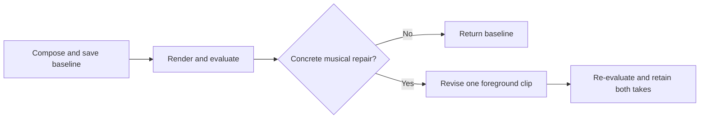

# Local composition refinement

The development harness follows three steps: **compose, evaluate, optionally revise
once**. It keeps the baseline and at most one local candidate. There is no automatic
musical winner or score threshold.



Run it with a musical brief and, optionally, a seed project:

```sh
uv run tools/eval/composition_refine.py --recipe tools/eval/references/composition-refine-pop-v2.json --output .local-evaluations/my-song --seed-project Song/Song.auris
```

The example uses the controlled 24-bar pop-vocal seed with a track named `Vocal`.
For another song, write a schema-version-2 recipe:

```json
{
  "schema_version": 2,
  "brief": "Compose a short pop vocal with a recurring motif and a clear chorus arrival.",
  "focus_track": "Vocal",
  "revision_scope": {
    "fields": ["pitch", "start", "length"],
    "max_changed_notes": 16
  }
}
```

Only `brief` and `focus_track` are required alongside the schema version.
The shown revision scope is the default. Optional `clip_ids` restricts eligible
clips. The reviewer may change **one** of those clips, within the note budget.
A seed starts a fresh foreground composition using its existing notes and lyrics;
the initial composition can rewrite foreground pitch/start/length while preserving
the other tracks and settings. The revision scope applies to the subsequent repair.
Without a seed, the agent creates the named monophonic foreground from a blank fixture.

## Shared machine configuration

The default configuration is
`~/.config/auris-studio/composition-refinement.json`; use `--config` for another file.
Paths are resolved relative to that configuration file. Set these once:

```json
{
  "schema_version": 1,
  "executable": "C:/auris/panel-test.exe",
  "auris": "C:/auris/auris.exe",
  "evaluator_python": "C:/models/songeval/.venv/Scripts/python.exe",
  "songeval_config": "C:/models/songeval-config.json",
  "voice": "C:/voices/singer.voicevox.json",
  "speaker": "selected speaker"
}
```

`executable` is the real agent-panel test target described in
[composition trials](composition-quality.md). Optional `source_suite` binds a reused
executable to its recorded source instead of today's checkout. Omit voice/speaker
for instrumental work. Optional settings are `model` (default `gpt-6.1-sol`),
`backend` (`codex`), `prompt_profile` (`legacy`) and `timeout` (900 seconds).
The composition agent uses its configured provider/account; SongEval runs locally.

## Evaluation and repair

A shared assessment function synthesizes vocals when needed, renders the mix,
checks finite/audible/unclipped PCM, and runs SongEval. The agent then reads the
score, the brief and all five predicted axes. It either keeps the song or explains
one concrete local repair, its expected benefit and tradeoff. A low score alone
does not identify a repair. The harness determines whether anything changed from
the actual note diff, without requiring a separate model-response JSON protocol.

No-change outcomes skip the second synthesis, render and evaluation. A changed
candidate uses the same assessment path, with duration and evaluator-condition
checks. Lyrics, note count/order, accompaniment, form, tempo, sounds, gain and effects
are protected by the project comparison. The original project and its Audio copy are
checked for mutation. External library references still require the same available assets.

The usual output is two full mixes, editable projects, a short report and
`listening.html`. Logs, prompts, source/model hashes and failed snapshots remain
available for audit. Only the baseline mix exists for a no-change outcome.
Add `--auditions` to render foreground and backing as well; only that mode compares
backing audio hashes. Those extra views are separate full-master renders, not additive
stems. All views retain original gain without independent normalization.

The baseline remains selected even if all five scores rise. A failed revision
returns status `baseline_only_revision_failed`, preserves the usable baseline,
and exits unsuccessfully so automation cannot mistake a failure for a good candidate.
An initial failure has no selected take. There is no automatic retry or candidate chain.

## SongEval environment and standalone scoring

Use a Python 3.11 uv environment with
[songeval-requirements.txt](../tools/eval/songeval-requirements.txt), the local
[SongEval source/checkpoint](https://github.com/ASLP-lab/SongEval) and a local
[MuQ snapshot](https://huggingface.co/OpenMuQ/MuQ-large-msd-iter).
The initial downloads require network access; inference forces offline mode.
No weights are included in an application release.

```sh
uv venv --python 3.11.15 .local-evaluations/songeval/.venv
uv pip install --python .local-evaluations/songeval/.venv/Scripts/python.exe -r tools/eval/songeval-requirements.txt
```

On macOS/Linux use `.venv/bin/python`. The separate SongEval configuration is:

```json
{
  "upstream": "C:/models/SongEval",
  "upstream_revision": "848fb2ff3a2a9d64dcb20d46f07238c28abd7add",
  "checkpoint": "C:/models/SongEval/ckpt/model.safetensors",
  "muq": "C:/models/MuQ-local-snapshot",
  "threads": 4
}
```

The tested MuQ snapshot is `0562a57814f6f8bbd9fdea0a25921a2fce1a841a`.
The adapter checks the source revision and records source/configuration, weights,
packages and preprocessing. SongEval's README states CC-BY-NC-SA 4.0 while its LICENSE
says Apache 2.0 at this revision; this integration uses separately acquired weights
for development research and does not assert commercial-use clearance.

```sh
<songeval-python> tools/eval/songeval.py --config songeval-config.json --output scores.json before.wav after.wav
```

Alternatively use `--manifest inputs.json` with `{id, path}` entries. Optional
`group` and `condition` (`before`/`after`) produce per-axis deltas. Failed inputs
remain in the report and make the command unsuccessful. The default duration cap
is 120 seconds; longer music needs documented excerpts or an explicit
`--max-seconds` override and sufficient memory.

SongEval receives mono 24 kHz audio without gain normalization and uses MuQ hidden
layer 6. Its five axes are Coherence, Musicality, Memorability, Clarity and Naturalness.
Naturalness concerns vocal phrasing/breathing; Clarity concerns song structure.
There is no rhythm-specific score or timestamped diagnosis, and Memorability is not
a delayed-recall test. The [paper](https://arxiv.org/abs/2505.10793) describes English
and Chinese full songs; Japanese synthesized vocals and short instrumental excerpts
require separate listening calibration.

## Validation and retained studies

```sh
uv run --with pytest --with numpy --with soundfile pytest tools/eval/test_songeval.py tools/eval/test_composition_refine.py tools/eval/test_composition_quality.py
uv run --with ruff ruff check tools/eval/songeval.py tools/eval/composition_refine.py tools/eval/test_songeval.py tools/eval/test_composition_refine.py
```

The [initial evaluator trial](local-music-evaluators-2026-10-26.ja.md) retains repeat
and silence controls and disagreement with listeners. The [first loop](songeval-refinement-2026-10-26.ja.md)
records the earlier multi-candidate runner's one-candidate pilot; its frozen artifacts
remain historical evidence. The [reference-song calibration](songeval-reference-2026-10-26.ja.md)
includes the NAS collection, a fresh official-source download and excerpt sensitivity.
None establishes an automatic selection threshold.

The [simplified workflow trial](simple-refinement-2026-10-26.ja.md) records a real
no-change decision: one mix and one SongEval call, with the second assessment skipped.
Candidate and failure paths are covered by regression tests; listener preference was
not measured in that trial.
